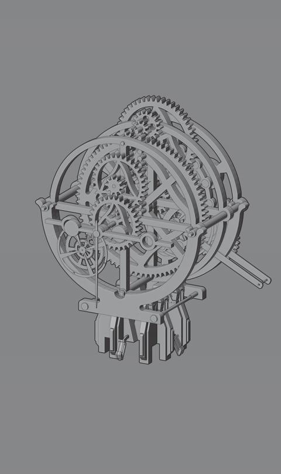
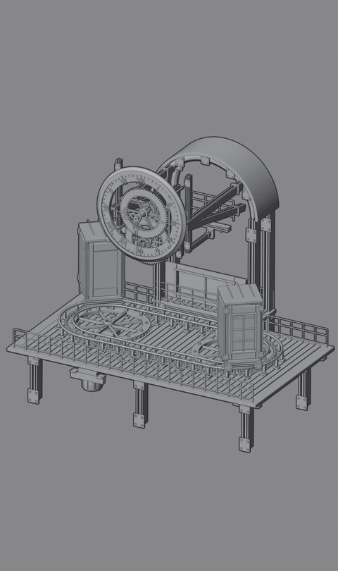
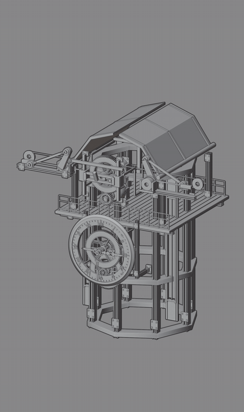

# STEAMPUNK CLOCKWORK

### A reusable library of mechanical form and motion

**46 animated Blender assets · 32 clocks · 14 mechanical assemblies · Editable controls**

[Product on Superhive](https://superhivemarket.com/products/steampunk-clockwork-animated-assets) · [Download camera tour (MP4)](https://github.com/MuwenTriLi/steampunk-clockwork-showcase/raw/refs/heads/main/media/collection-tour.mp4) · [Render gallery](docs/render-gallery.md) · [Motion library](docs/motion-library.md)

Steampunk Clockwork turns a design language of exposed gears, layered mechanisms and architectural frames into an adaptable Blender asset library. Use a complete assembly as a focal point, tune its motion to a shot, or develop a new composition from its editable components.

I began with my own model collection and a set of design standards. Those standards guided the mechanical variations, the level of detail and the way movement is presented. Codex assisted with inspecting the files and developing structures within that direction.

## Motion is part of the design

<table>
<tr><th width="50%">CLK08 · Rotating clockwork</th><th width="50%">SPM14 · Suspended mechanism</th></tr>
<tr><td></td><td></td></tr>
<tr><th>CLK31 · Guided travel</th><th>CLK32 · Opening and folding</th></tr>
<tr><td></td><td></td></tr>
</table>

The neutral Blender views make the moving structure readable: small rotating parts, linked assemblies, travel along a constrained path and unfolding architectural elements. These excerpts preserve the original playback speed. [More motion and viewport recordings](docs/motion-library.md).

## Selected forms

<table>
<tr>
<td width="50%"> <b>CLK08 · Exposed clock movement</b></td>
<td width="50%"> <b>SPM14 · Equinox differential instrument</b></td>
</tr>
<tr>
<td width="50%"> <b>CLK31 · Orbit archive exchange</b></td>
<td width="50%"> <b>CLK32 · Aperture observatory</b></td>
</tr>
</table>

Four different silhouettes share a vocabulary of metal surfaces, visible transmission parts and intricate secondary details. [Browse 26 selected renders](docs/render-gallery.md), including the original CLK01–22 series.

## A control system behind each assembly

Built-in settings drive motion through native Blender drivers, object hierarchies and constraints. Adjust the root controller; the connected parts follow their existing relationships.

**Controller inputs → linked motion → moving components**

| What you want to change | Example controls | What they affect |
| --- | --- | --- |
| Chain movement | SPM03 · `Chain_Drive_Speed` | Chain speed, alongside the assembly's overall speed and phase settings. |
| Gear rotation | CLK08 · `Gear_Display_Speed` | Visible mechanism speed; clock-hand timing has separate controls. |
| Opening and folding rhythm | CLK32 · `Master_RPM`, `Speed_Scale`, `Phase_Deg` | The input speed and phase driving the unfolding mechanism. |
| Travel along an existing path | CLK31 · `Master_RPM`, `Speed_Scale` | The pace of the connected rail mechanism. |
| Clock behavior | CLK08 · `Start_Hour`, `Start_Minute`, `Start_Second`, `Second_Tick_Blend` | Initial time and smooth or stepped seconds. |
| Gear detail on supported assets | CLK31 / CLK32 · `Teeth_Multiplier` | Linked tooth density at 1 / 2 / 3, with pitch radii and transmission ratios retained. |

Controls vary by asset. Opening angles and positions may be calculated outputs, so adjustments belong upstream in the controller. [Explore the controls](docs/controls.md).

## Components for a new design

The library works at three levels: **complete animated assemblies**, **editable parts and subassemblies**, and **reusable procedural materials**. A clock can anchor a scene; its gears, frames and decorative structures can also inform a new design or visual direction.

<table>
<tr>
<td width="33%"> <b>Layered gear detail</b></td>
<td width="33%"> <b>Frame and linkage detail</b></td>
<td width="33%"> <b>Dense clock-face detail</b></td>
</tr>
</table>

For a working animated module, retain its controller, hierarchy and driver dependencies. For a new visual composition, duplicate the asset, make its collection instance real and adapt selected geometry or materials. A separated component may need its motion relationships rebuilt. [Component reuse workflow](docs/component-reuse.md).

## From design rules to a usable product

| Stage | Design responsibility | Result |
| --- | --- | --- |
| Establish the language | Original models, design direction and evaluation standards | A consistent starting point for new structures. |
| Develop the mechanism | Review variations and how their parts move together | Detailed forms with legible motion. |
| Expose the controls | Organize adjustment points for each assembly | Reusable assets with documented parameters. |
| Package the collection | Categories, previews, materials and instructions | A library another Blender user can browse, place and adapt. |

[Design and development process](docs/process.md) · [Creative workflows portfolio](https://github.com/MuwenTriLi/creative-workflows)

## Browse · place · adjust · animate

Register the product's `Asset Library` folder in Blender, choose a complete asset collection, place it in your scene, then select its root controller to adjust the available parameters.

<b>See the library inside Blender</b>

[Download the 15-second library tour](https://github.com/MuwenTriLi/steampunk-clockwork-showcase/raw/refs/heads/main/media/blender-library-tour.mp4) · [Collection animation in the viewport](https://github.com/MuwenTriLi/steampunk-clockwork-showcase/raw/refs/heads/main/media/viewport-collection.mp4)

| Included | Delivery |
| --- | --- |
| Animated assets | 32 clocks and 14 mechanical assemblies |
| Asset Browser | Categorized library with 46 custom previews |
| Materials | 9 marked reusable procedural material assets |
| Presentation | 5 supplied showcase scenes |
| Documentation | Setup, controller reference and recorded release checks |
| Format | Editable native Blender files; no add-on required to use the model library |

Get the commercial asset package on [Superhive](https://superhivemarket.com/products/steampunk-clockwork-animated-assets). This repository presents the project and selected media.

<b>Compatibility and presentation notes</b>

The package records testing in Blender 5.2.0 LTS on Windows with Cycles. These are detailed visualization assets; viewport performance depends on the scene. Run/reset behavior and cycles vary between assets. The existing release audit was not rerun for this showcase.

All visuals come from the supplied renders and recordings. GIFs are excerpts rather than guaranteed seamless cycles. See [verification scope](docs/validation.md) and [media provenance](docs/media.md).

The commercial Blender files are distributed through the product page. This showcase does not grant an open-source license to those assets.

