# STEAMPUNK CLOCKWORK

### From a designer's production rules to an adaptable asset library

**46 animated Blender assets / 32 clocks / 14 mechanical assemblies / Editable controls**

**[Read the production-to-product case](docs/production-case.md)** — the problem, design decisions, role of AI, creator controls and delivery checks.

I built from my own model collection and design standards, using Codex to assist development. The result connects detailed visual craft with an editable product workflow. The packaged instruction Skill is a later extension whose new end-to-end execution remains to be verified.

[Open the full-resolution 3840 x 2160 render](media/collection-hero-4k.jpg)

[Workflow + Skill](docs/workflow-skill.md) / [Read SKILL.md](skills/clockwork-assembly/SKILL.md) / [Download camera tour (MP4)](https://github.com/MuwenTriLi/steampunk-clockwork-showcase/raw/refs/heads/main/media/collection-tour.mp4) / [Render gallery](docs/render-gallery.md) / [Motion library](docs/motion-library.md) / [Product on Superhive](https://superhivemarket.com/products/steampunk-clockwork-animated-assets)

Steampunk Clockwork turns a design language of exposed gears, layered mechanisms and architectural frames into an adaptable Blender asset library. Use a complete assembly as a focal point, tune its motion to a shot, or develop a new composition from its editable components.

I began with my own model collection and a set of design standards. Those standards guided the mechanical variations, the level of detail and the way movement is presented. Codex assisted with inspecting the files and developing structures within that direction.

## The reusable workflow behind the assets

The project combines **designed components**, **linked motion logic** and **an agent-guided adaptation workflow**. Its gears, frames, chains and architectural modules can be reused as complete assemblies or developed into a new composition, with the required motion dependencies retained or rebuilt.

| Reusable capability | What it enables |
| --- | --- |
| Design rules | Develop related mechanical structures from an original model collection and a consistent visual brief. |
| Motion logic | Connect controller inputs to gear rotation, chain movement, guided travel and unfolding. |
| Parameter controls | Tune speed, phase and clock behavior without editing every moving component. |
| Modular assembly | Reuse a complete mechanism or adapt selected parts, subassemblies and procedural materials. |
| Product delivery | Browse, place and adjust an organized Asset Browser library with previews and instructions. |

The [`clockwork-assembly` Skill](skills/clockwork-assembly/SKILL.md) packages the inspection, adaptation and checking procedure as reusable agent instructions. It was distilled for this showcase from the existing project workflow; a new end-to-end Skill run is still to be verified. [Explore the workflow, inputs and outputs](docs/workflow-skill.md).

## The collection in motion

## Motion is part of the design

24 motion studies in one four-column collection: eight rotating views first, followed by 16 fixed-view mechanisms. Click a card to inspect it.

<table>
<tr><th colspan="4" align="left">01 / Rotating views</th></tr>
<tr>
<td width="25%" align="center"><a href="media/motion-clk02.gif">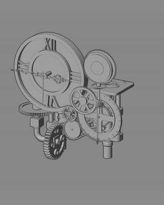</a> <b>Clock 01</b> Turntable / Layered dial</td>
<td width="25%" align="center"><a href="media/motion-clk03.gif">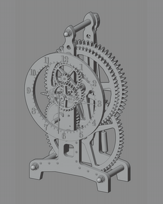</a> <b>Clock 02</b> Turntable / Open frame</td>
<td width="25%" align="center"><a href="media/motion-clk04.gif">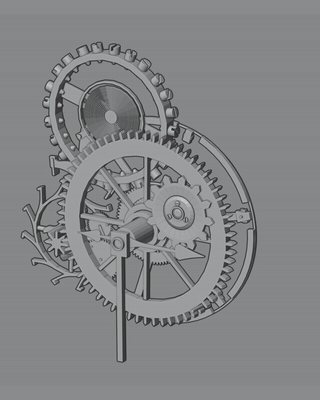</a> <b>Clock 03</b> Turntable / Stacked gears</td>
<td width="25%" align="center"><a href="media/motion-clk05.gif">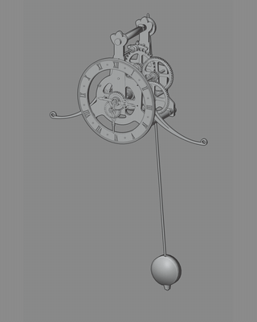</a> <b>Clock 04</b> Turntable / Suspended pendulum</td>
</tr>
<tr>
<td width="25%" align="center"><a href="media/motion-clk06.gif">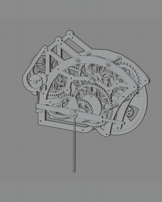</a> <b>Clock 05</b> Turntable / Linked frame</td>
<td width="25%" align="center"><a href="media/motion-clk07.gif">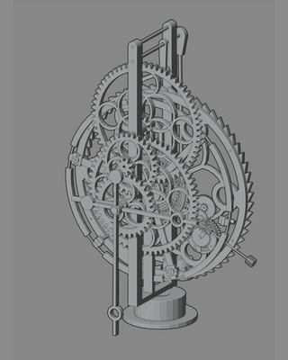</a> <b>Clock 06</b> Turntable / Vertical gears</td>
<td width="25%" align="center"> <b>Clock 07</b> Turntable / Exposed movement</td>
<td width="25%" align="center"><a href="media/motion-clk10.gif">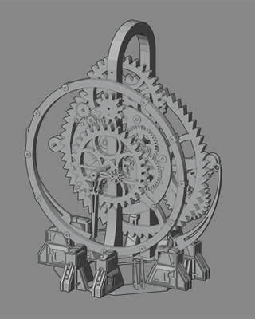</a> <b>Clock 08</b> Turntable / Skeleton frame</td>
</tr>
<tr><th colspan="4" align="left">02 / Fixed views - moving mechanisms</th></tr>
<tr>
<td width="25%" align="center"><a href="media/motion-clk09.gif">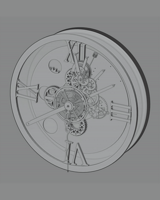</a> <b>Clock 09</b> Motion / Open dial</td>
<td width="25%" align="center"><a href="media/motion-clk11.gif">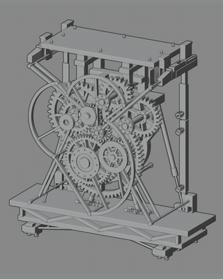</a> <b>Clock 10</b> Motion / Framed gear train</td>
<td width="25%" align="center"><a href="media/motion-clk12.gif">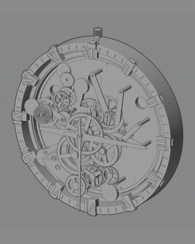</a> <b>Clock 11</b> Motion / Dense clock face</td>
<td width="25%" align="center"><a href="media/motion-clk14.gif">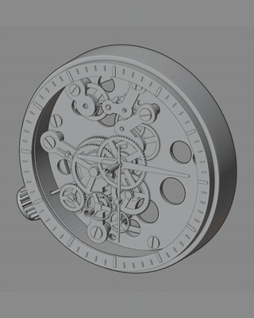</a> <b>Clock 12</b> Motion / Mechanical dial</td>
</tr>
<tr>
<td width="25%" align="center"><a href="media/motion-clk15.gif">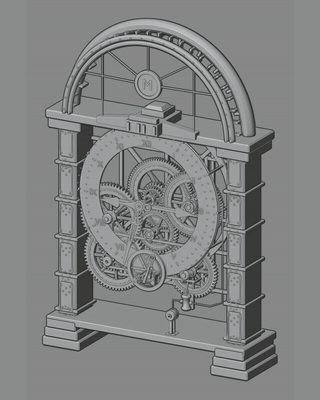</a> <b>Clock 13</b> Motion / Arched frame</td>
<td width="25%" align="center"><a href="media/motion-clk17.gif">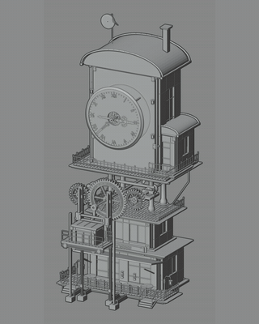</a> <b>Clock 14</b> Motion / Lift and tower</td>
<td width="25%" align="center"><a href="media/motion-clk18.gif">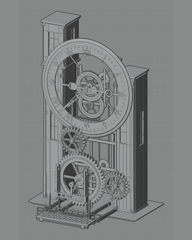</a> <b>Clock 15</b> Motion / Vertical linkages</td>
<td width="25%" align="center"><a href="media/motion-clk20.gif">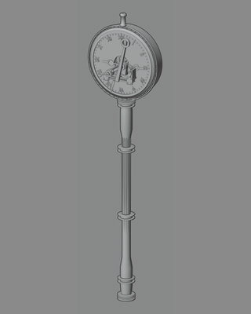</a> <b>Clock 16</b> Motion / Clock column</td>
</tr>
<tr>
<td width="25%" align="center"><a href="media/motion-clk22.gif">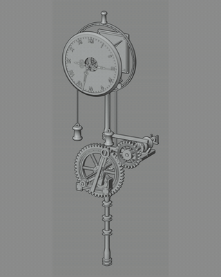</a> <b>Clock 17</b> Motion / Side linkage</td>
<td width="25%" align="center"><a href="media/motion-clk24.gif">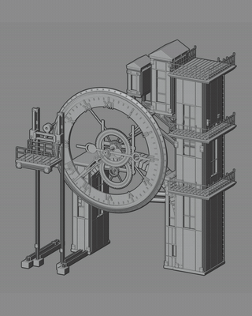</a> <b>Clock 18</b> Motion / Dial and lift</td>
<td width="25%" align="center"><a href="media/motion-clk25.gif">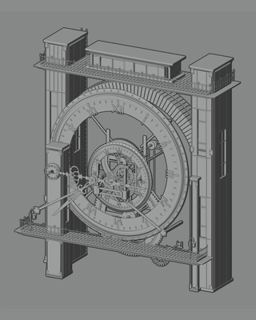</a> <b>Clock 19</b> Motion / Architectural dial</td>
<td width="25%" align="center"><a href="media/motion-clk27.gif">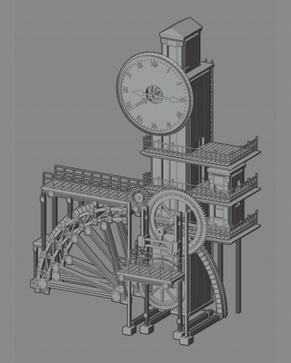</a> <b>Clock 20</b> Motion / Folding structure</td>
</tr>
<tr>
<td width="25%" align="center"><a href="media/motion-clk28.gif">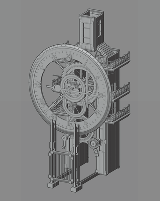</a> <b>Clock 21</b> Motion / Tower mechanism</td>
<td width="25%" align="center"><a href="media/motion-clk29.gif">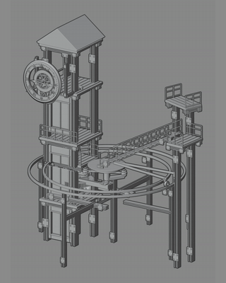</a> <b>Clock 22</b> Motion / Elevating walkway</td>
<td width="25%" align="center"> <b>Clock 23</b> Motion / Rail-guided motion</td>
<td width="25%" align="center"> <b>Clock 24</b> Motion / Unfolding canopy</td>
</tr>
</table>

Clock 01-24 are presentation numbers for this browsing order. Original asset IDs remain in the [clock index](docs/clock-index.md). All 24 cards are animated GIFs. GIFs are five-second excerpts at the original playback speed, repeated for browsing. [More motion and viewport recordings](docs/motion-library.md).

## Selected forms

<table>
<tr>
<td width="25%" align="center"> <b>CLK02</b></td>
<td width="25%" align="center"> <b>CLK03</b></td>
<td width="25%" align="center"> <b>CLK04</b></td>
<td width="25%" align="center"> <b>CLK06</b></td>
</tr>
<tr>
<td width="25%" align="center"> <b>CLK08</b></td>
<td width="25%" align="center"> <b>CLK10</b></td>
<td width="25%" align="center"> <b>CLK11</b></td>
<td width="25%" align="center"> <b>CLK12</b></td>
</tr>
<tr>
<td width="25%" align="center"> <b>CLK18</b></td>
<td width="25%" align="center"> <b>CLK31</b></td>
<td width="25%" align="center"> <b>CLK32</b></td>
<td width="25%" align="center"> <b>SPM14</b></td>
</tr>
</table>

Twelve selected forms from the clock and mechanical collection. Click a render for its original-resolution view. [Browse all 32 clocks and selected mechanisms](docs/render-gallery.md).

## A control system behind each assembly

Built-in settings drive motion through native Blender drivers, object hierarchies and constraints. Adjust the root controller; the connected parts follow their existing relationships.

**Controller inputs -> linked motion -> moving components**

| What you want to change | Example controls | What they affect |
| --- | --- | --- |
| Chain movement | SPM03 / `Chain_Drive_Speed` | Chain speed, alongside the assembly's overall speed and phase settings. |
| Gear rotation | CLK08 / `Gear_Display_Speed` | Visible mechanism speed; clock-hand timing has separate controls. |
| Opening and folding rhythm | CLK32 / `Master_RPM`, `Speed_Scale`, `Phase_Deg` | The input speed and phase driving the unfolding mechanism. |
| Travel along an existing path | CLK31 / `Master_RPM`, `Speed_Scale` | The pace of the connected rail mechanism. |
| Clock behavior | CLK08 / `Start_Hour`, `Start_Minute`, `Start_Second`, `Second_Tick_Blend` | Initial time and smooth or stepped seconds. |
| Gear detail on supported assets | CLK31 / CLK32 / `Teeth_Multiplier` | Linked tooth density at 1 / 2 / 3, with pitch radii and transmission ratios retained. |

Controls vary by asset. Opening angles and positions may be calculated outputs, so adjustments belong upstream in the controller. [Explore the controls](docs/controls.md).

## Components for a new design

The library works at three levels: **complete animated assemblies**, **editable parts and subassemblies**, and **reusable procedural materials**. A clock can anchor a scene; its gears, frames and decorative structures can also inform a new design or visual direction.

<table>
<tr>
<td width="25%" align="center"> <b>Gear layers</b></td>
<td width="25%" align="center"> <b>Linkages</b></td>
<td width="25%" align="center"> <b>Clock-face detail</b></td>
<td width="25%" align="center"> <b>Chain drive</b></td>
</tr>
</table>

For a working animated module, retain its controller, hierarchy and driver dependencies. For a new visual composition, duplicate the asset, make its collection instance real and adapt selected geometry or materials. A separated component may need its motion relationships rebuilt. [Component reuse workflow](docs/component-reuse.md).

## From design rules to a usable product

| Stage | Design responsibility | Result |
| --- | --- | --- |
| Establish the language | Original models, design direction and evaluation standards | A consistent starting point for new structures. |
| Develop the mechanism | Review variations and how their parts move together | Detailed forms with legible motion. |
| Expose the controls | Organize adjustment points for each assembly | Reusable assets with documented parameters. |
| Package the collection | Categories, previews, materials and instructions | A library another Blender user can browse, place and adapt. |

[Design and development process](docs/process.md) / [Creative workflows portfolio](https://github.com/MuwenTriLi/creative-workflows)

## Browse / place / adjust / animate

Register the product's `Asset Library` folder in Blender, choose a complete asset collection, place it in your scene, then select its root controller to adjust the available parameters.

<b>See the library inside Blender</b>

[Download the 15-second library tour](https://github.com/MuwenTriLi/steampunk-clockwork-showcase/raw/refs/heads/main/media/blender-library-tour.mp4) / [Collection animation in the viewport](https://github.com/MuwenTriLi/steampunk-clockwork-showcase/raw/refs/heads/main/media/viewport-collection.mp4)

| Included | Delivery |
| --- | --- |
| Animated assets | 32 clocks and 14 mechanical assemblies |
| Asset Browser | Categorized library with 46 custom previews |
| Materials | 9 marked reusable procedural material assets |
| Presentation | 5 supplied showcase scenes |
| Documentation | Setup, controller reference and recorded release checks |
| Format | Editable native Blender files; no add-on required to use the model library |

Get the commercial asset package on [Superhive](https://superhivemarket.com/products/steampunk-clockwork-animated-assets). This repository presents the project and selected media.

<b>Compatibility and presentation notes</b>

The package records testing in Blender 5.2.0 LTS on Windows with Cycles. These are detailed visualization assets; viewport performance depends on the scene. Run/reset behavior and cycles vary between assets. The existing release audit was not rerun for this showcase.

All visuals come from the supplied renders and recordings. GIFs are excerpts rather than guaranteed seamless cycles. See [verification scope](docs/validation.md) and [media provenance](docs/media.md).

The commercial Blender files are distributed through the product page. This showcase does not grant an open-source license to those assets.

