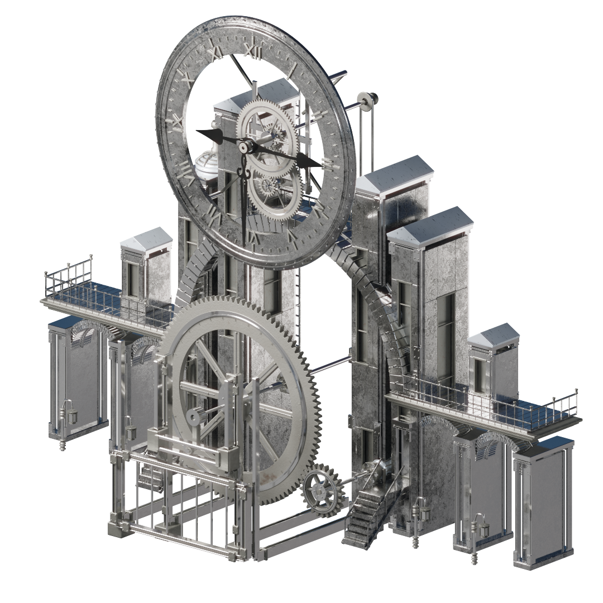
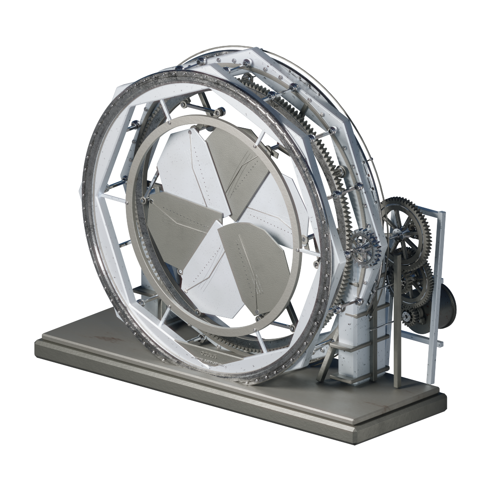
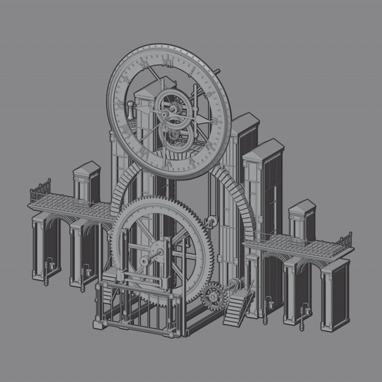
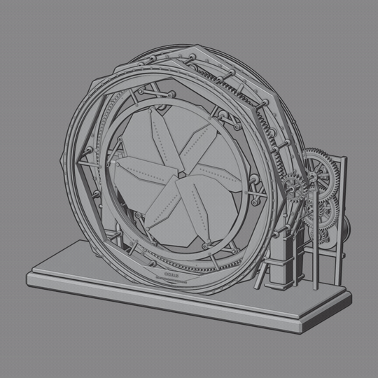

# STEAMPUNK CLOCKWORK

### 46 animated assets for Blender

**32 clocks · 14 mechanical assemblies · Native animation controls · Asset Browser ready**

[View on Superhive](https://superhivemarket.com/products/steampunk-clockwork-animated-assets) · [Watch the camera tour](media/collection-tour.mp4) · [Render gallery](docs/render-gallery.md) · [Creative workflows](https://github.com/MuwenTriLi/creative-workflows)

Mechanical clocks, architectural structures and moving assemblies for Blender scenes. The collection combines detailed metal forms with editable motion, so an asset can become the focus of a shot or part of a larger environment.

## The collection in motion

An excerpt from the supplied **Overall** render. The [1080p camera tour](media/collection-tour.mp4) shows a wider selection of clocks and architectural mechanisms. [More collection views](docs/render-gallery.md#collection-views) include the portrait composition.

## Four structures, one visual language

<table>
<tr>
<td width="50%"> <b>CLK08 · Exposed clock movement</b> Layered wheels, shafts and a readable mechanical silhouette.</td>
<td width="50%"> <b>CLK23 · Meridian palace</b> A clock face, central gear and architectural arcade in one assembly.</td>
</tr>
<tr>
<td width="50%"> <b>SPM11 · Oculus iris gate</b> Radial leaves, an outer ring and the surrounding drive mechanism.</td>
<td width="50%"> <b>SPM14 · Equinox</b> A suspended instrument with exposed linkages and counterweights.</td>
</tr>
</table>

These images are existing renders from the supplied asset thumbnails. Click a render to inspect it at full size in the [gallery](docs/render-gallery.md#individual-assets).

## From rendered form to mechanical motion

<table>
<tr><th width="50%">Meridian palace · CLK23</th><th width="50%">Oculus iris gate · SPM11</th></tr>
<tr>
<td></td>
<td></td>
</tr>
</table>

The gray-shaded studies isolate the moving geometry. The rendered views above show the same assemblies with their metal materials. Both studies come from existing animation videos; they preserve the source playback speed.

## Controls a creator can use

Assets use native Blender drivers, hierarchies and constraints. Controls live on each asset's root `*_ASSET_CTRL` object, keeping common adjustments together while the mechanism remains assembled.

| Example | Control | Creative use |
| --- | --- | --- |
| CLK08 | `Start_Hour`, `Start_Minute`, `Start_Second` | Set the clock's initial displayed time. |
| CLK08 | `Second_Tick_Blend` | Choose between a smooth seconds sweep and one-second steps. |
| CLK08 | `Gear_Display_Speed` | Adjust the visible mechanism's speed. |
| CLK23 | `Master_RPM`, `Phase_Deg` | Change the input speed and starting phase. |
| SPM11 | `Master_RPM` | Set the iris mechanism's main input speed. |

Controls vary by asset. [The control walkthrough](docs/controls.md) explains these examples, placement and the distinction between editable inputs and calculated outputs.

## Designed to be reused in Blender

1. **Browse:** register the supplied `Asset Library` folder and choose a clock, machine or material.
2. **Place:** append or instance the complete asset collection, keeping its dependencies together.
3. **Adjust:** select the root controller and tune the controls available on that asset.
4. **Animate:** preview its motion, compose the shot and render in Blender.

<b>See the Asset Browser and in-Blender workflow</b>

Custom previews and categories make the collection browsable. The screen recording shows interaction inside Blender, alongside the finished renders and motion studies above.

## Design direction and AI-assisted development

I began with my existing model collection, established the design direction and set the standards for evaluating new structures. Codex inspected details in those files and assisted in developing mechanical variations within that direction.

My contribution was the source material, visual direction and design judgment guiding the work. The resulting product brings the structures together as editable assets with controls, previews, organized collections and documentation.

[Read the development process](docs/process.md) for the source-model → design-direction → assisted-development → product-delivery workflow.

## What the product includes

| Component | Delivery |
| --- | --- |
| Animated collections | 32 clock designs and 14 mechanical assemblies |
| Asset Browser | Categorized library with 46 custom previews |
| Materials | 9 marked reusable procedural material assets |
| Presentation | 5 supplied showcase scenes |
| Documentation | Setup guide, controller reference and recorded release checks |
| Native files | Editable Blender files; no add-on required to use the model library |

The commercial package is available on [Superhive](https://superhivemarket.com/products/steampunk-clockwork-animated-assets). This repository contains the case study and selected presentation media.

<b>Compatibility, verification and media provenance</b>

The supplied package records testing in Blender 5.2.0 LTS on Windows with Cycles. These are detailed visualization assets; viewport performance depends on scene complexity. Motion cycles and run/reset behavior vary by asset.

The existing release audit was not rerun while preparing this case. See [validation scope](docs/validation.md), [media sources and transformations](docs/media.md) and the [render gallery](docs/render-gallery.md).

The commercial Blender files are distributed through the product page. This showcase does not grant an open-source license to those assets.

