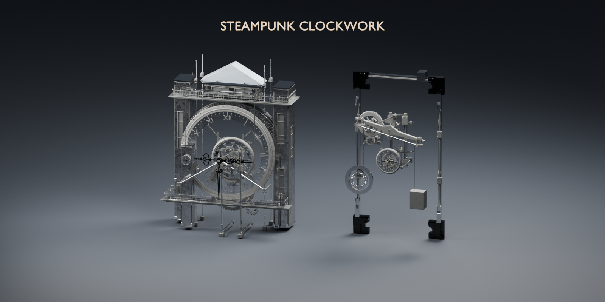
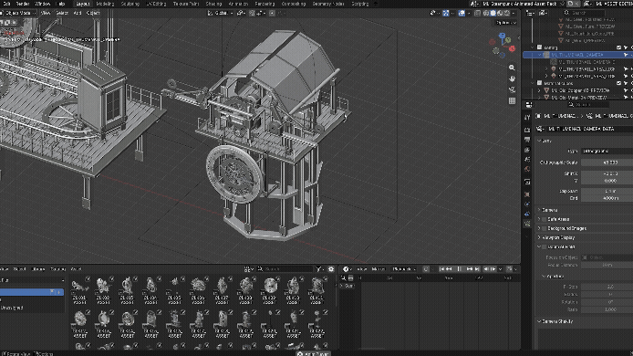

# Steampunk Clockwork

**46 animated Blender assets developed from an original model collection, with human design direction and Codex-assisted iteration.**

[Product on Superhive](https://superhivemarket.com/products/steampunk-clockwork-animated-assets) · [Creative workflows](https://github.com/MuwenTriLi/creative-workflows) · [Design and development process](docs/process.md)

## The project

Steampunk Clockwork turns a collection of mechanical forms into a reusable visualization product: **32 clocks, 14 mechanical assemblies, 9 marked procedural material assets, and 5 showcase scenes**. Assets are organized in Blender's Asset Browser with custom previews and editable animation controls.

This is a native Blender asset library. It does not require an add-on. This repository presents the product and its development process; the commercial asset package is available through Superhive.

## My role and the use of AI

I supplied the original model collection, set the design direction and defined the standards used to judge each variation. Codex inspected details in those files and assisted in developing new mechanical structures within that direction. The work combines my source material and design judgment with AI-assisted inspection and implementation.

The case focuses on how that collaboration became an organized, controllable product. It does not claim that every component was hand-coded or that the tool independently defined the design.

## Using the assets

1. Add the package's **Asset Library** folder in Blender preferences.
2. Browse clocks, machines and materials using the supplied categories and previews.
3. Append or place a complete asset collection, keeping its hierarchy intact.
4. Adjust the asset's root custom properties and preview the animation.

The short recording below shows interaction with an asset in Blender. It is a workflow demonstration rather than a final render.

## Technical decisions

- Native Blender drivers, object hierarchies and constraints keep the animation editable in Blender.
- Collection assets, bottom-center origins and categorized previews support placement and reuse.
- Root controls expose parameters such as time, speed, phase and run/reset behavior; availability varies by asset.
- Documentation separates user controls from calculated outputs and records the scope of release checks.

## Compatibility and limits

The supplied package documentation records testing in **Blender 5.2.0 LTS on Windows with Cycles**. That is the documented release environment, not a new verification performed while preparing this portfolio.

These are high-detail visualization assets. Viewport playback depends on the selected assets and scene complexity. Mechanisms use different cycles; the complete collection is not a single synchronized seamless loop. The systems are visual animation rigs, not engineering simulations.

See [documented validation and limitations](docs/validation.md) and [media provenance](docs/media.md).

## Repository contents

- `README.md` — overview and selected demonstrations.
- `docs/` — design process, documented checks and media provenance.
- `media/` — lightweight copies of selected existing presentation assets.

The commercial Blender files and original working material are not included. No open-source license is granted for the commercial asset package by this showcase.
