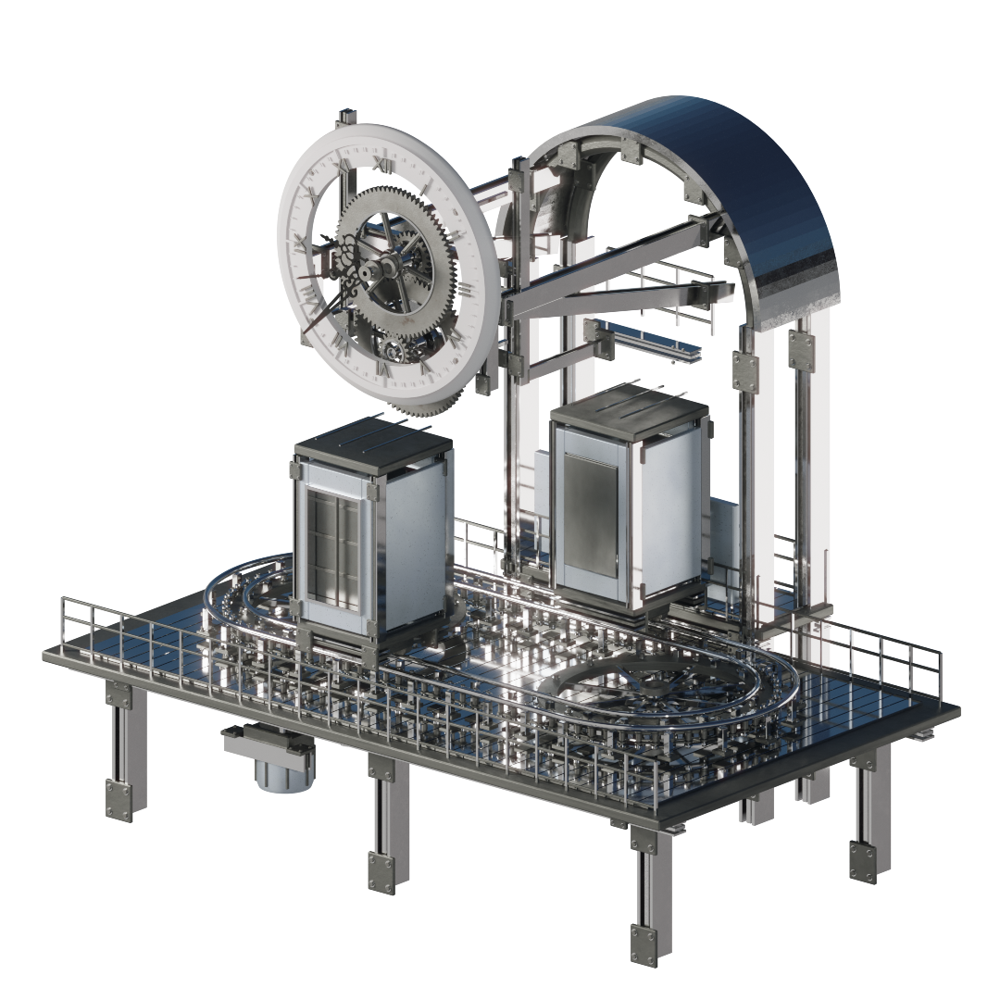
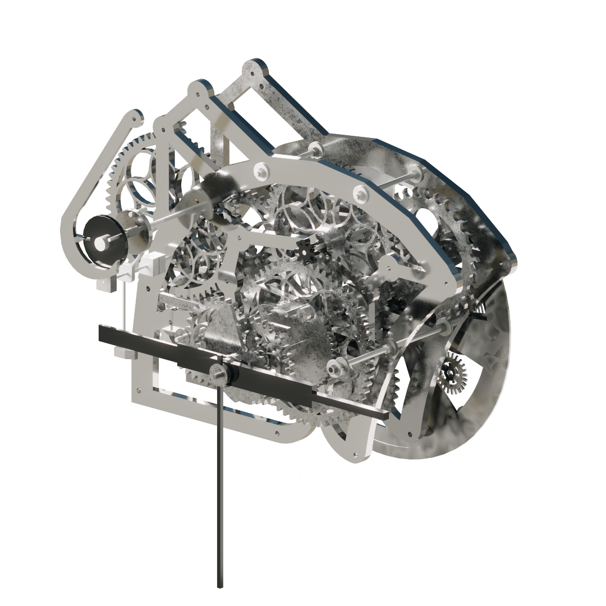
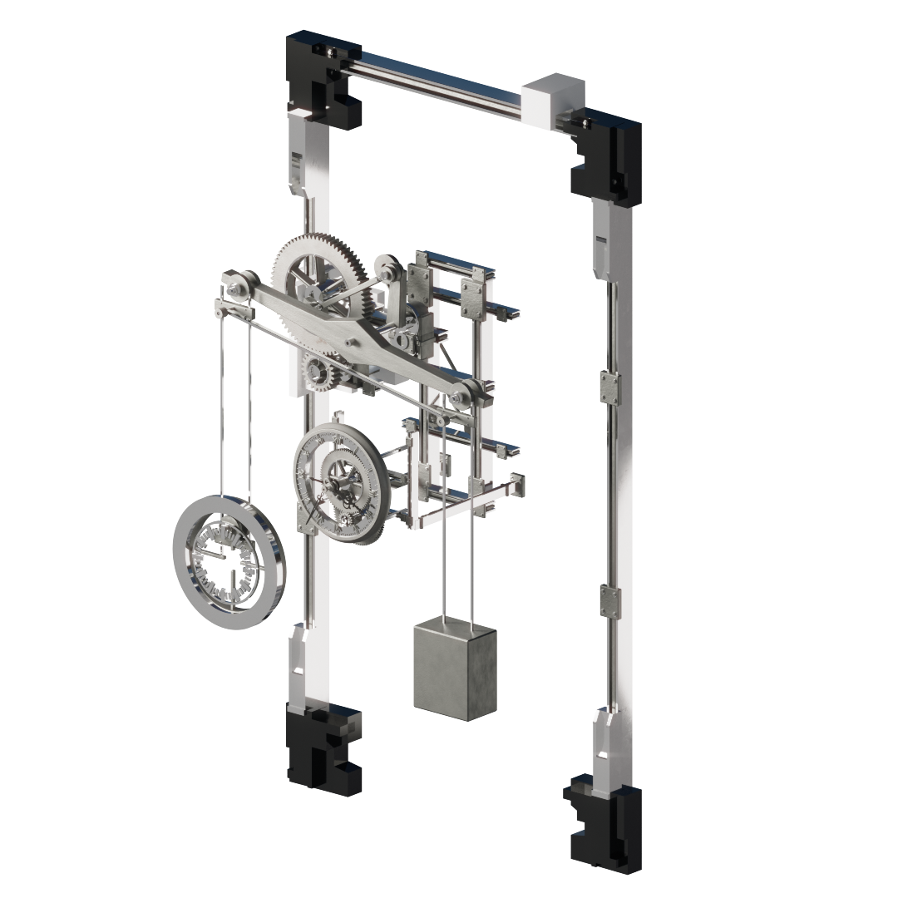

# Reuse an assembly, a component or a material

[Case study](../README.md)  /  [Render gallery](render-gallery.md)  /  [Controls](controls.md)

The collection is intended to be adapted to new compositions and visual directions. Its editable Blender structure supports different levels of reuse.

## 1  /  Keep the complete mechanism

Place a complete clock or machine into a scene, adjust its overall position and scale, and tune its available motion controls. This preserves the relationships that make the asset animate as a unit.

## 2  /  Develop a component into a new design

Start with a duplicate of the asset and make the collection instance real. Review the component hierarchy before selecting gears, frames, shafts or decorative parts to use elsewhere. Adapt the composition, geometry and materials to the new design direction.

An animated subassembly needs its controller, target objects and constraints. Retain those dependencies when transferring motion; if you isolate only the visible mesh, rebuild the relevant motion relationships. Reusing a component visually is a different task from transferring its entire rig.

<table>
<tr>
<td width="33%"> <b>CLK04</b></td>
<td width="33%"> <b>CLK06</b></td>
<td width="33%"> <b>SPM14</b></td>
</tr>
</table>

## 3  /  Carry the material language into a new scene

The product includes nine marked procedural material assets. These can support a consistent metal treatment across a new composition, or provide editable shader starting points. The supplied appearance uses native procedural nodes; no baked texture-map set is included.

For agent-assisted adaptation, the [Clockwork assembly Skill](../skills/clockwork-assembly/SKILL.md) packages this sequence with controller guidance and explicit handover outputs.

## A practical adaptation sequence

1. Choose a complete asset whose silhouette or movement suits the design.
2. Append a local copy and preserve an untouched reference in the working scene.
3. Decide whether the new design needs the complete animated module or selected geometry.
4. Retain or rebuild motion dependencies as appropriate; then adjust materials and composition.
5. Preview the changed asset through its full intended motion range before rendering.

These are adaptation guidelines for the existing library, not a demonstration of an already-built derivative project. asset use remains subject to the product's license.
