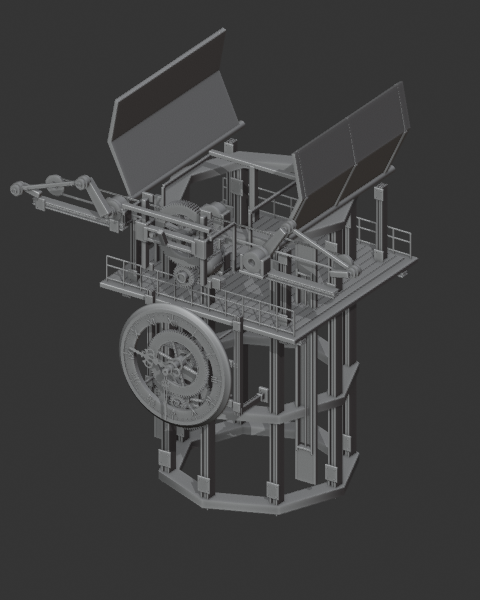
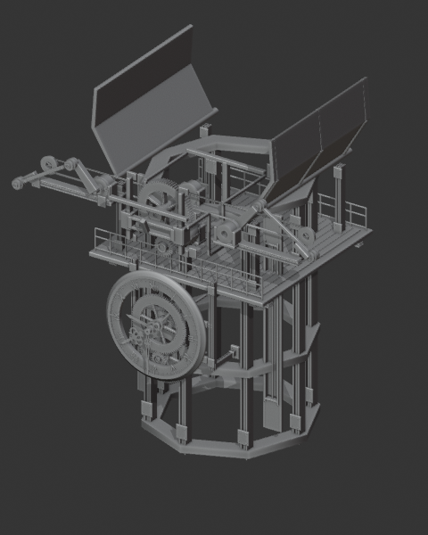

# A checked control change: CLK32

[← Clockwork](../README.md) · [Controller reference](controls.md#opening-and-folding--clk32-aperture) · [Machine-readable result](../media/control-study/results.json)

**Task:** slow the existing opening mechanism by 25%, retain its motion dependencies and keep the commercial source unchanged. This is a portfolio demonstration performed on October 26, 2026, not a client commission or a user study.

## Watch the exact revision

[Play the 10-second before/after MP4](../media/control-study/clk32-speed-comparison.mp4). **Left: original speed 1.0. Right: revised speed 0.75.** Both use the same camera, diagnostic Workbench lighting and frames 1–240 at 24 fps. The clip is an inspection render, not a replacement for the product's finished showcase.

| Original · Speed 1.0 | Revised · Speed 0.75 |
| --- | --- |
|  |  |

## Inspect → change → check

1. Append the complete `CLK32_ASSET` collection into a separate working scene. Identify its actual root, `CLK32_ASSET_CTRL`, and inspect its properties and driver targets.
2. Record `Master_RPM = 3.2` and `Speed_Scale = 1.0`. Change only the upstream `Speed_Scale` input to **0.75**; leave the 81 object-driver expressions and target relationships intact.
3. Evaluate every frame from **1 through 601 at 24 fps**, at both settings. Check driver validity, target references and finite object transforms for this 155-object collection.
4. Compare the root's input-angle change: **8.37758064 → 6.28318548 radians**, a measured ratio of **0.75**. Save a separate working copy and render the comparison. The original library's SHA-256 is unchanged.

## Actual result and limits

On **Blender 5.2.0 LTS / Windows**, both evaluations reported zero invalid object drivers, missing object-driver targets or non-finite object transforms. The driver graph was unchanged. The ten-second comparison decodes to 240 frames at 24 fps.

The first attempt on **Blender 5.0.1** found invalid geometry-node modifier input paths on this asset; it stopped rather than reporting success. Repeating the task in the library's documented 5.2 environment passed. This does not establish support for every Blender version.

The two stills were visually inspected, and the encoded comparison was fully decoded. These checks do not establish collision-free motion, usability by an unfamiliar creator, validity of arbitrary settings or correctness across all 46 assets. A new commercial release needs its own full audit.

## Who controlled the work

Muwen's original models and existing mechanism supplied the design and dependencies. Codex followed the published assembly Skill to inspect the local source, adjust the actual input, evaluate the working copy and produce this record. The speed-change brief was an explicit demonstration chosen for the portfolio. There was no new model training, API-generated geometry, autonomous redesign or measured time-saving claim.

**Decision:** retain upstream controls for repeatable timing edits. Next, ask an unfamiliar creator to repeat this task and explain how to restore the original setting. Recomposition or dependency changes require a separate review. The commercial `.blend` remains outside this public repository.
