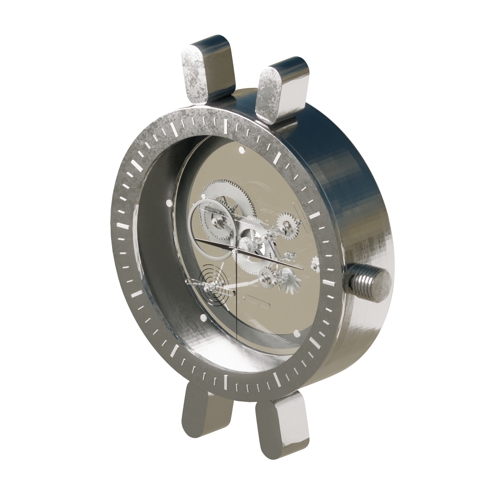
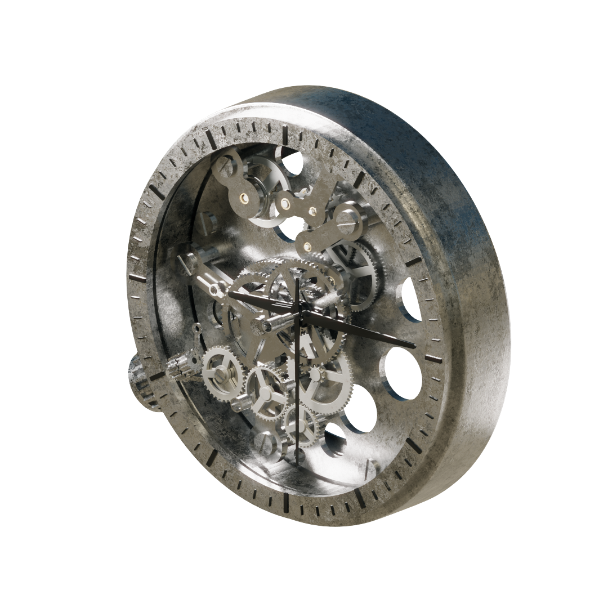
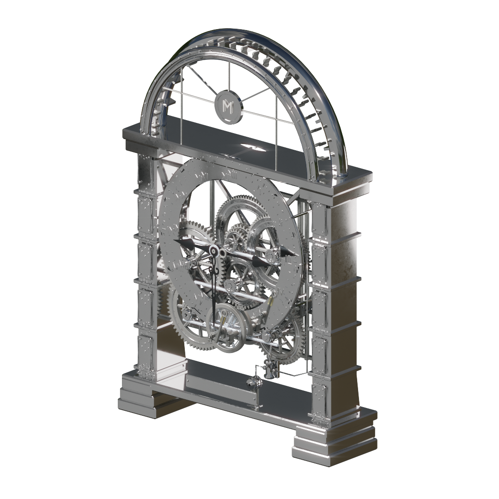
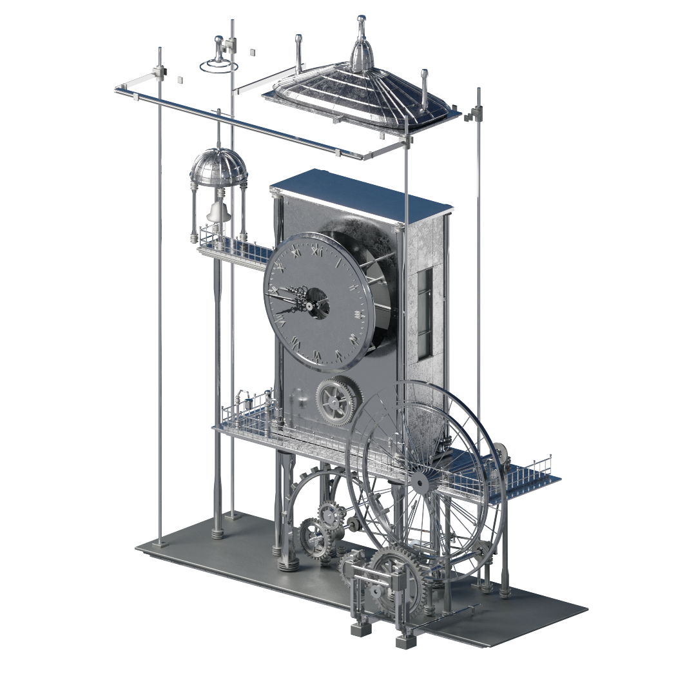
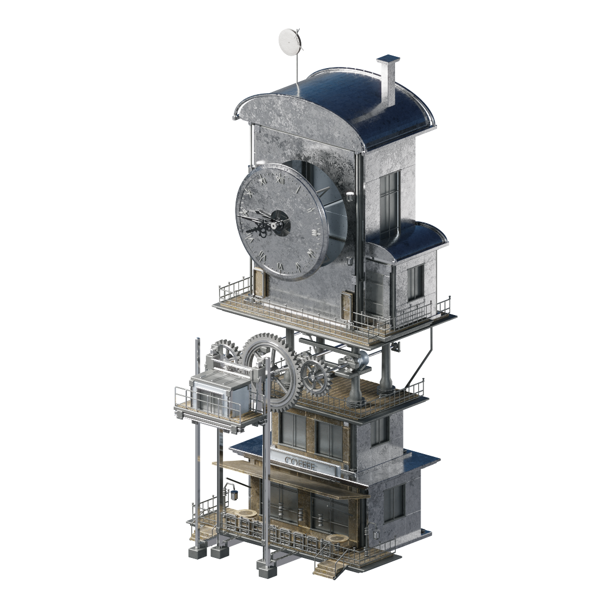
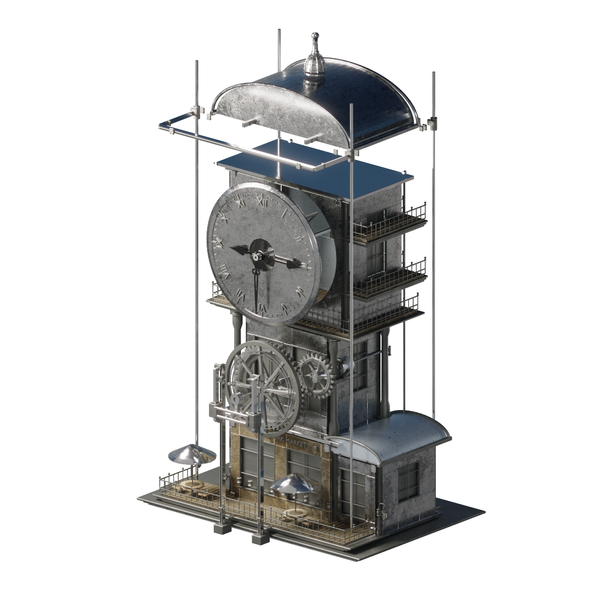
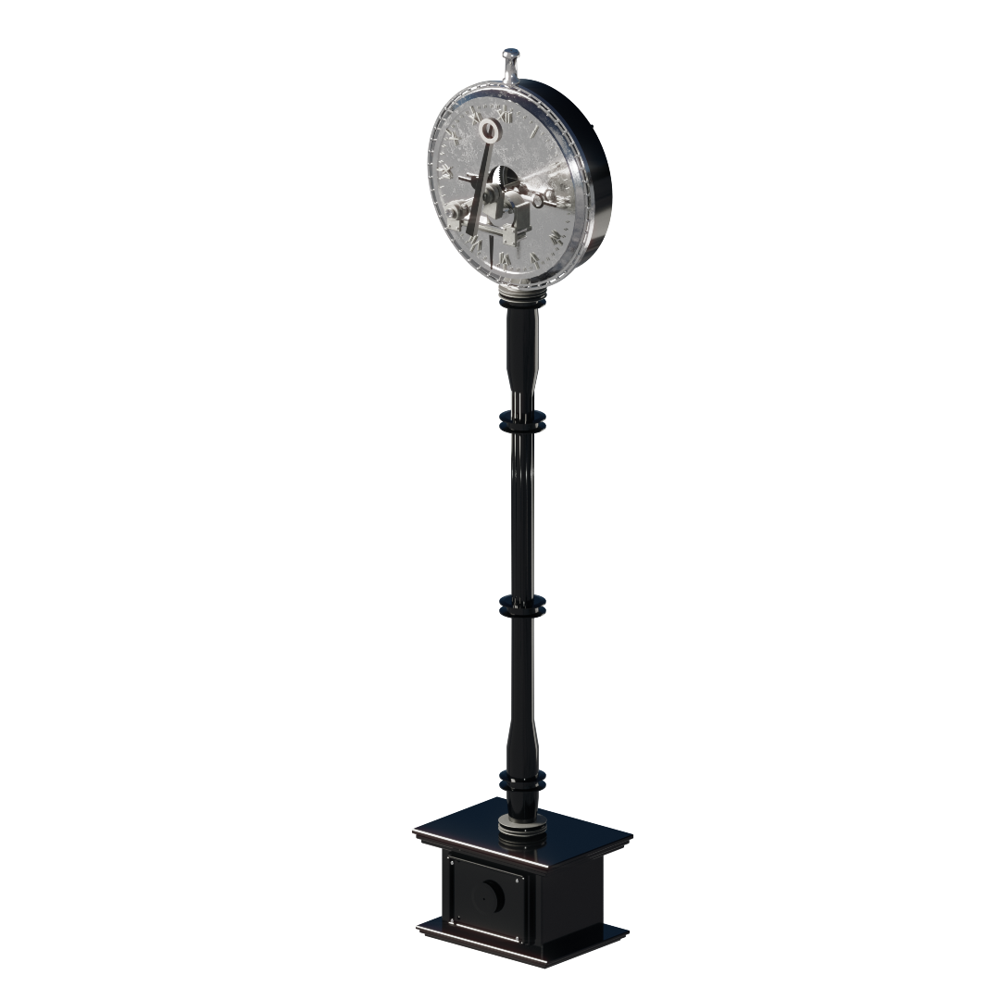
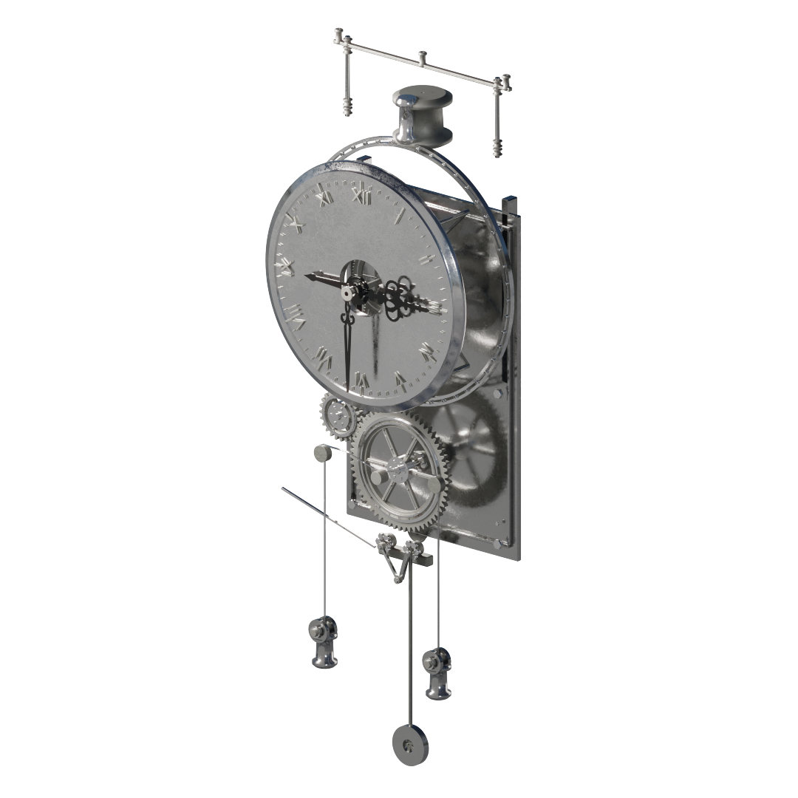
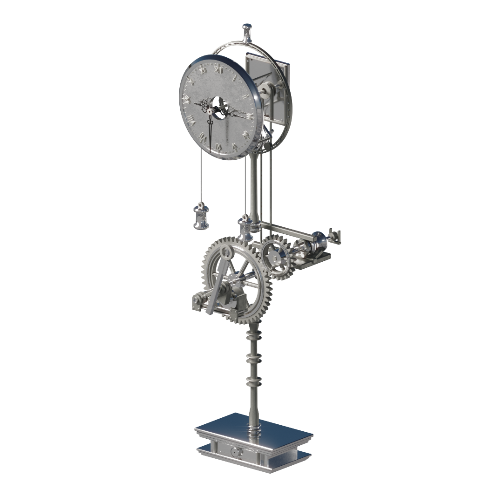

# Original clock series / 13-22

[Case study](../README.md) / [Gallery index](render-gallery.md) / [Clocks 01-12](gallery-clocks-01-12.md) / [Clocks 13-22](gallery-clocks-13-22.md)

Original rendered thumbnails selected by the author. Click any image for its full-size view.

<em>Left to right:</em> <b>CLK13</b>; <b>CLK14</b>; <b>CLK15</b>; <b>CLK16</b>

<em>Left to right:</em> <b>CLK17</b>; <b>CLK18</b>; <b>CLK19</b>; <b>CLK20</b>

<em>Left to right:</em> <b>CLK21</b>; <b>CLK22</b>

