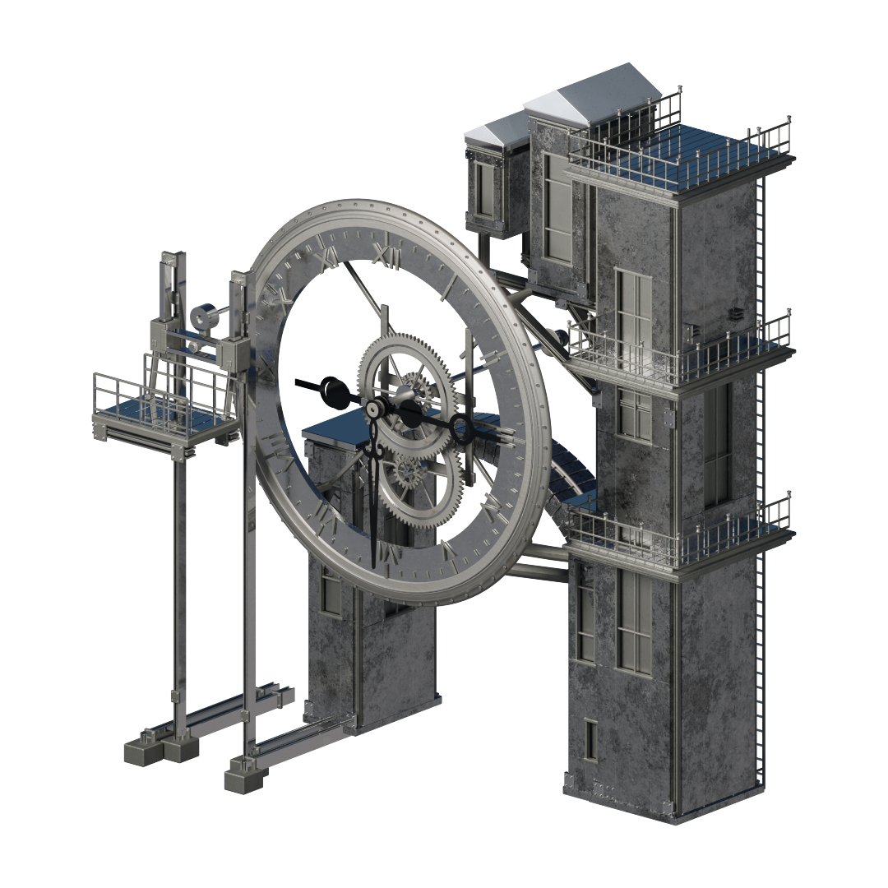
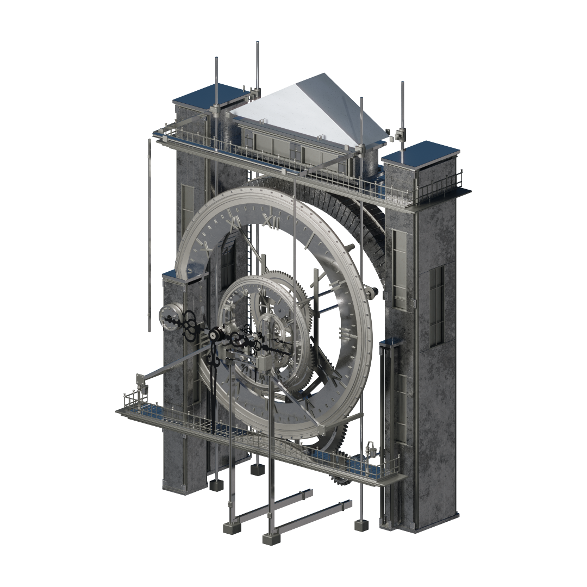
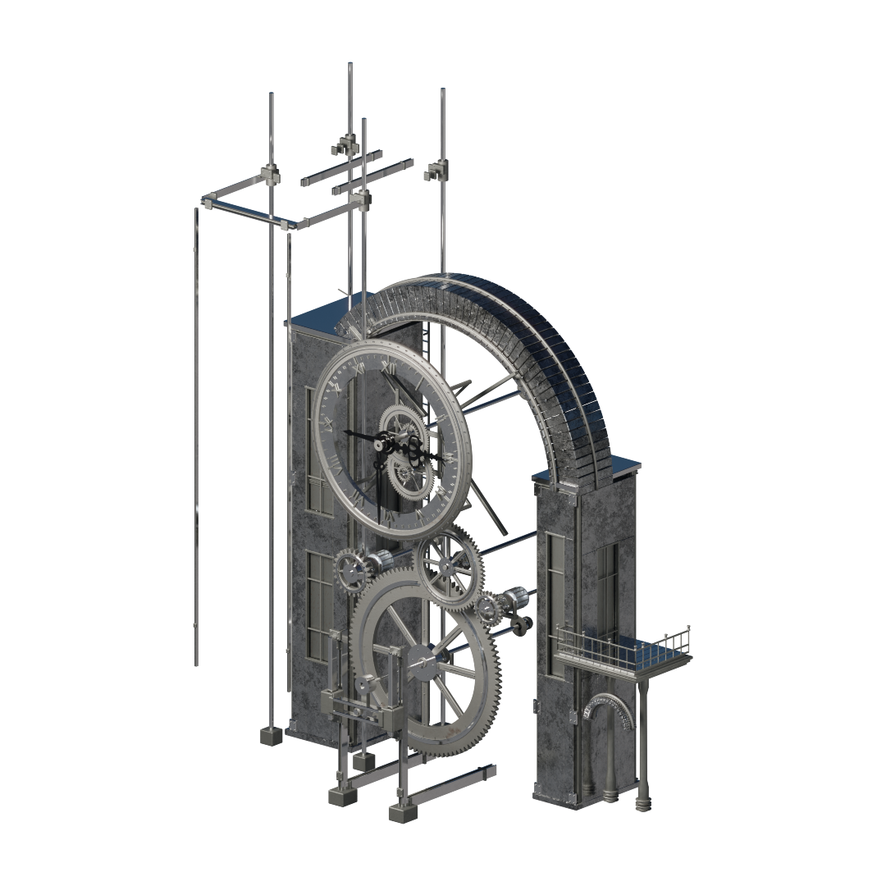
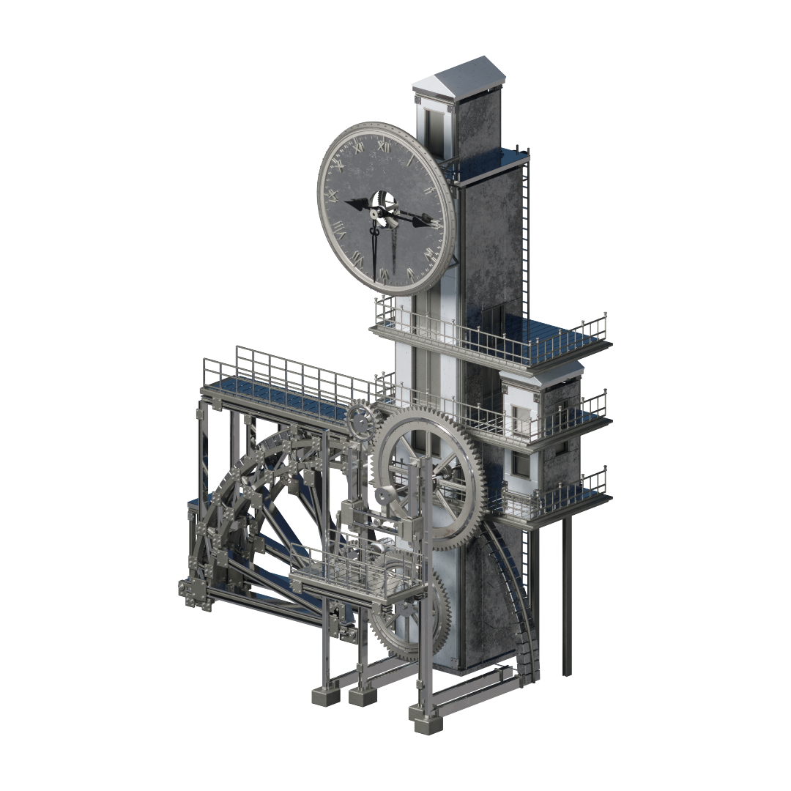
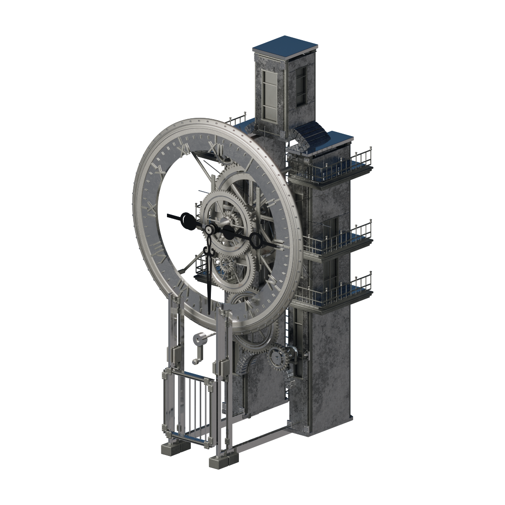
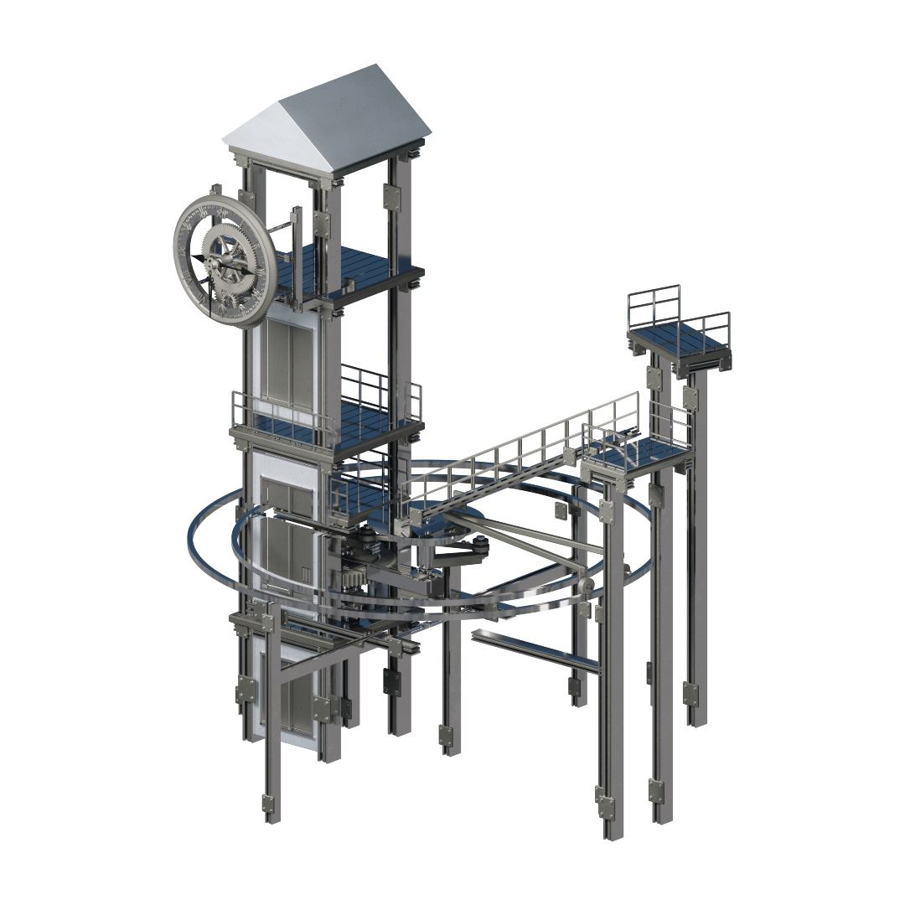
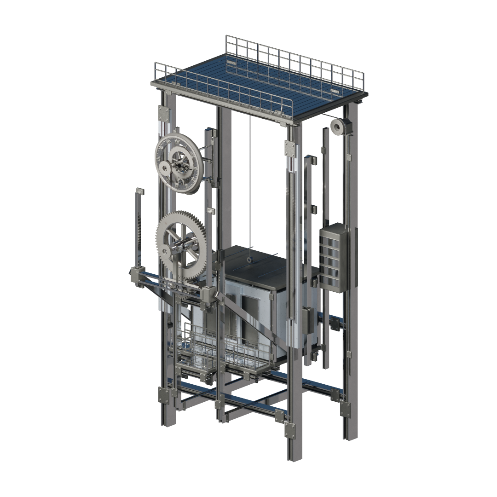

# Clocks 23-32

[Case study](../README.md) / [Render gallery](render-gallery.md) / [Clocks 01-12](gallery-clocks-01-12.md) / [Clocks 13-22](gallery-clocks-13-22.md)

Original asset numbers. Each image opens at its supplied resolution.

<em>Left to right:</em> <b>CLK23</b>; <b>CLK24</b>; <b>CLK25</b>; <b>CLK26</b>

<em>Left to right:</em> <b>CLK27</b>; <b>CLK28</b>; <b>CLK29</b>; <b>CLK30</b>

<em>Left to right:</em> <b>CLK31</b>; <b>CLK32</b>

