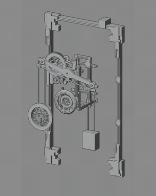

# Motion library

[Case study](../README.md) / [Rendered assets](render-gallery.md) / [Controls](controls.md)

## Finished collection

[Download the 1080p camera tour](https://github.com/MuwenTriLi/steampunk-clockwork-showcase/raw/refs/heads/main/media/collection-tour.mp4). The rendered metal surfaces and camera movement present the collection as a finished product.

## 20 individual mechanisms

Four previews per row, organized as a compact library. Click any card to inspect its motion individually.

<table>
<tr>
<td width="25%" align="center"> <b>CLK08</b></td>
<td width="25%" align="center"> <b>SPM14</b></td>
<td width="25%" align="center"> <b>CLK31</b></td>
<td width="25%" align="center"> <b>CLK32</b></td>
</tr>
<tr>
<td width="25%" align="center"> <b>CLK02</b></td>
<td width="25%" align="center"> <b>CLK03</b></td>
<td width="25%" align="center"> <b>CLK04</b></td>
<td width="25%" align="center"> <b>CLK05</b></td>
</tr>
<tr>
<td width="25%" align="center"> <b>CLK06</b></td>
<td width="25%" align="center"> <b>CLK07</b></td>
<td width="25%" align="center"> <b>CLK09</b></td>
<td width="25%" align="center"> <b>CLK10</b></td>
</tr>
<tr>
<td width="25%" align="center"> <b>CLK11</b></td>
<td width="25%" align="center"> <b>CLK12</b></td>
<td width="25%" align="center"> <b>CLK14</b></td>
<td width="25%" align="center"> <b>CLK15</b></td>
</tr>
<tr>
<td width="25%" align="center"> <b>CLK17</b></td>
<td width="25%" align="center"> <b>CLK18</b></td>
<td width="25%" align="center"> <b>CLK20</b></td>
<td width="25%" align="center"> <b>CLK22</b></td>
</tr>
</table>

Each card is a five-second excerpt at the original playback speed. A single conservative crop is used throughout each clip to reduce unused background while preserving the moving parts. Previews repeat for browsing; they are not presented as seamless cycles.

## Structure across the collection

<table>
<tr><th width="50%">Linework composition</th><th width="50%">Blender viewport animation</th></tr>
<tr><td></td><td></td></tr>
</table>

[Download linework collection](https://github.com/MuwenTriLi/steampunk-clockwork-showcase/raw/refs/heads/main/media/lineweight-collection.mp4) / [Download viewport collection](https://github.com/MuwenTriLi/steampunk-clockwork-showcase/raw/refs/heads/main/media/viewport-collection.mp4)

## Browse the asset library

The 15-second excerpt shows the assets and library inside Blender. It comes from the supplied `Recording Placeholders` recording.

Additional in-Blender workflow recording

## Product presentation

[Download the vertical presentation](https://github.com/MuwenTriLi/steampunk-clockwork-showcase/raw/refs/heads/main/media/product-presentation.mp4), combining the original product-page view and rendered footage.

MP4 links open a download for viewing in a video player. The GIFs above play directly in the page. All viewing copies are silent; no source audio was added. See [sources and preparation](media.md).
