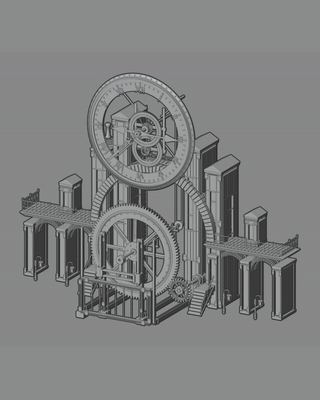
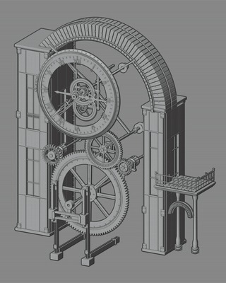
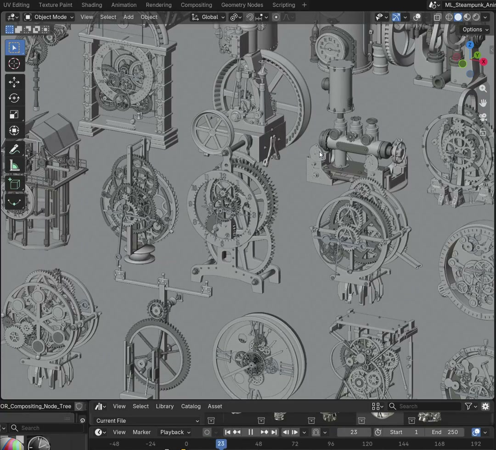

# Motion library

[Case study](../README.md) / [Rendered assets](render-gallery.md) / [Controls](controls.md)

## Finished collection

[Download the 1080p camera tour](https://github.com/MuwenTriLi/steampunk-clockwork-showcase/raw/refs/heads/main/media/collection-tour.mp4). The rendered metal surfaces and camera movement present the collection as a finished product.

## The complete clock collection

All 32 clocks in one collection: rotating views first, followed by fixed-view mechanisms and rendered details. Click a card to inspect it.

<table>
<tr><th colspan="4" align="left">01 / Rotating views</th></tr>
<tr>
<td width="25%" align="center"> <b>Clock 01</b> Turntable / Layered dial</td>
<td width="25%" align="center"> <b>Clock 02</b> Turntable / Open frame</td>
<td width="25%" align="center"> <b>Clock 03</b> Turntable / Stacked gears</td>
<td width="25%" align="center"> <b>Clock 04</b> Turntable / Suspended pendulum</td>
</tr>
<tr>
<td width="25%" align="center"> <b>Clock 05</b> Turntable / Linked frame</td>
<td width="25%" align="center"> <b>Clock 06</b> Turntable / Vertical gears</td>
<td width="25%" align="center"> <b>Clock 07</b> Turntable / Exposed movement</td>
<td width="25%" align="center"> <b>Clock 08</b> Turntable / Skeleton frame</td>
</tr>
<tr><th colspan="4" align="left">02 / Fixed views - moving mechanisms and rendered details</th></tr>
<tr>
<td width="25%" align="center"> <b>Clock 09</b> Motion / Open dial</td>
<td width="25%" align="center"> <b>Clock 10</b> Motion / Framed gear train</td>
<td width="25%" align="center"> <b>Clock 11</b> Motion / Dense clock face</td>
<td width="25%" align="center"> <b>Clock 12</b> Motion / Mechanical dial</td>
</tr>
<tr>
<td width="25%" align="center"> <b>Clock 13</b> Motion / Arched frame</td>
<td width="25%" align="center"> <b>Clock 14</b> Motion / Lift and tower</td>
<td width="25%" align="center"> <b>Clock 15</b> Motion / Vertical linkages</td>
<td width="25%" align="center"> <b>Clock 16</b> Motion / Clock column</td>
</tr>
<tr>
<td width="25%" align="center"> <b>Clock 17</b> Motion / Side linkage</td>
<td width="25%" align="center"> <b>Clock 18</b> Motion / Clockwork arcade</td>
<td width="25%" align="center"> <b>Clock 19</b> Motion / Dial and lift</td>
<td width="25%" align="center"> <b>Clock 20</b> Motion / Architectural dial</td>
</tr>
<tr>
<td width="25%" align="center"> <b>Clock 21</b> Motion / Arch and wheel</td>
<td width="25%" align="center"> <b>Clock 22</b> Motion / Folding structure</td>
<td width="25%" align="center"> <b>Clock 23</b> Motion / Tower mechanism</td>
<td width="25%" align="center"> <b>Clock 24</b> Motion / Elevating walkway</td>
</tr>
<tr>
<td width="25%" align="center"> <b>Clock 25</b> Motion / Rail-guided motion</td>
<td width="25%" align="center"> <b>Clock 26</b> Motion / Unfolding canopy</td>
<td width="25%" align="center"> <b>Clock 27</b> Render / Clockwork composition</td>
<td width="25%" align="center"> <b>Clock 28</b> Render / Enclosed clock face</td>
</tr>
<tr>
<td width="25%" align="center"> <b>Clock 29</b> Render / Architectural frame</td>
<td width="25%" align="center"> <b>Clock 30</b> Render / Clock tower</td>
<td width="25%" align="center"> <b>Clock 31</b> Render / Suspended dial</td>
<td width="25%" align="center"> <b>Clock 32</b> Render / Mechanical tower</td>
</tr>
</table>

Clock 01-32 are presentation numbers for this browsing order. Original asset IDs remain in the [clock index](clock-index.md). The collection includes 26 GIFs and six still renders; cards marked Render use the supplied original image where no individual animation clip was available. GIFs are five-second excerpts at the original playback speed, repeated for browsing.

## Structure across the collection

<table>
<tr><th width="50%">Linework composition</th><th width="50%">Blender viewport animation</th></tr>
<tr><td></td><td></td></tr>
</table>

[Download linework collection](https://github.com/MuwenTriLi/steampunk-clockwork-showcase/raw/refs/heads/main/media/lineweight-collection.mp4) / [Download viewport collection](https://github.com/MuwenTriLi/steampunk-clockwork-showcase/raw/refs/heads/main/media/viewport-collection.mp4)

## Browse the asset library

The 15-second excerpt shows the assets and library inside Blender. It comes from the supplied `Recording Placeholders` recording.

Additional in-Blender workflow recording

## Product presentation

[Download the vertical presentation](https://github.com/MuwenTriLi/steampunk-clockwork-showcase/raw/refs/heads/main/media/product-presentation.mp4), combining the original product-page view and rendered footage.

MP4 links open a download for viewing in a video player. The GIFs above play directly in the page. All viewing copies are silent; no source audio was added. See [sources and preparation](media.md).
