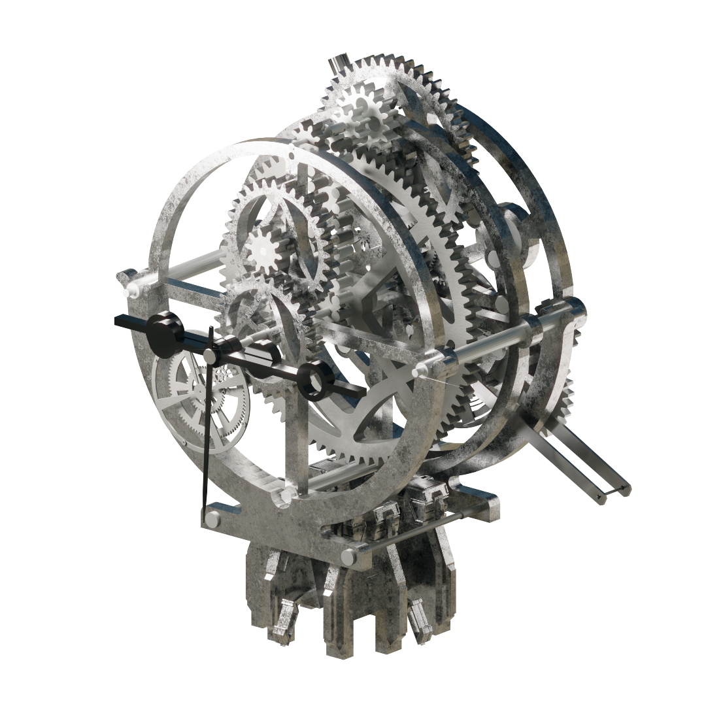

# A design system expressed through mechanical assets

[Back to the case study](../README.md)

## Start with work I modeled myself

I modeled the original source collection before this AI-assisted workflow. I then organized those models and references and supplied them to Codex with my design direction: detailed mechanical structures whose silhouette, gear layers, frames and movement could be read together.

That preparation is part of the work. The input gives the AI concrete geometry and a visual standard to inspect; the brief gives it a task. I selected and reviewed the resulting variations, and directed which forms and movements belonged in the library. The models were task inputs and references, not a newly trained AI model.

## Turn the prepared inputs into linked behavior

I used Codex to assist source inspection and the development of related mechanisms and gear linkages. The implementation expresses motion through native Blender drivers, object hierarchies and constraints. My responsibility was to set the intended visual and mechanical relationships and judge the results.

| Input or decision | Resulting system behavior | Evidence |
| --- | --- | --- |
| My modeled components and design references | Related forms developed within a consistent visual direction | [Original collection and finished studies](render-gallery.md) |
| A need to adjust mechanism rhythm | Upstream speed and phase inputs propagate through linked parts | [Gear, chain and travel controls](controls.md) |
| A need to open a larger assembly coherently | Inputs drive the opening; the calculated angle remains a result | [CLK32 control example](controls.md#opening-and-folding--clk32-aperture) |
| A need to reuse a mechanism in another scene | Preserve the controller, hierarchy and dependent targets together | [Reuse procedure](component-reuse.md) |

The available artifacts show the developed system and its documented controls. A complete source-to-output development recording remains evidence to add. A later [single-control adaptation](control-study.md) records a real adjustment and its checks; it does not reconstruct the original development history.

## Connect form, detail and movement

The resulting assets use exposed gears, layered frames and secondary mechanisms in different configurations. Some remain compact clock movements; others expand into architectural assemblies with guided travel or unfolding parts. The fine rotations are part of the presentation, alongside the larger silhouette and motion.

<table>
<tr>
<td width="33%"> <b>CLK08</b></td>
<td width="33%"> <b>CLK31</b></td>
<td width="33%"> <b>CLK32</b></td>
</tr>
</table>

## Make the result adjustable

Reusable assets need meaningful adjustment points. The supplied controllers expose functions such as gear speed, chain speed, clock timing, phase and the input driving a larger mechanism. Native drivers and constraints carry those inputs through connected parts.

The control reference distinguishes editable settings from calculated outputs. That distinction helps a user adapt the timing while preserving the existing mechanism.

## Package the work for another creator

The product combines 46 animated asset collections, categorized Asset Browser entries, custom previews, procedural materials, presentation scenes and documentation. Together these provide a browse -> place -> adjust -> animate workflow.

Components can also become source material for a new design. The [reuse guide](component-reuse.md) describes how to preserve animation dependencies when adapting a module, or work with selected geometry and materials.

## Make the method reusable

The [workflow Skill](workflow-skill.md) turns the documented adaptation method into explicit agent instructions: inspect the source and dependencies, choose a level of reuse, tune the available inputs, and check the working copy. The Skill is packaged alongside the case so a reviewer can inspect the procedure as well as its existing visual evidence.

## Evidence in this showcase

The [render gallery](render-gallery.md) shows the supplied visual work, the [motion library](motion-library.md) shows existing animation and Blender recordings, and the [control guide](controls.md) summarizes documented parameters. The showcase makes no claim about measured time savings or a newly executed technical audit. See [validation scope](validation.md).
