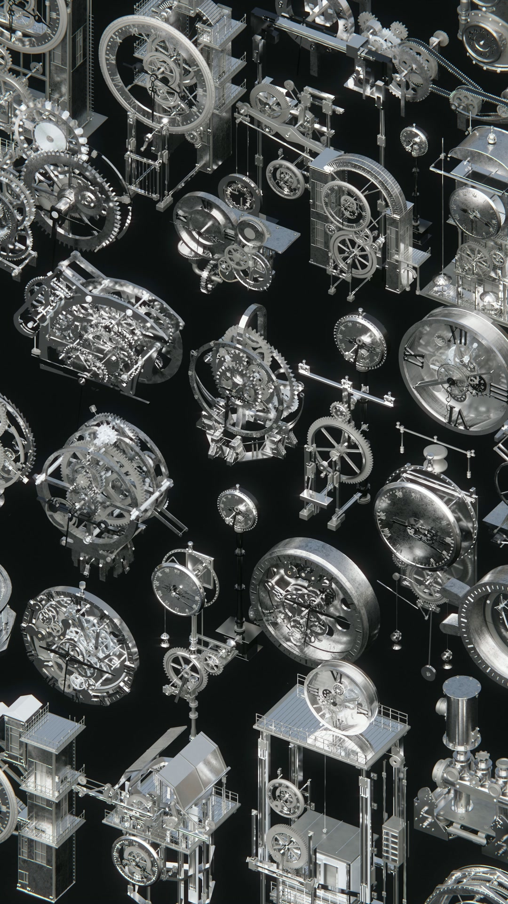

# Render gallery

[Case study](../README.md) / [Clocks 01-12](gallery-clocks-01-12.md) / [Clocks 13-22](gallery-clocks-13-22.md) / [Motion library](motion-library.md)

26 selected original asset renders, with the author's preferred clock series presented first. Images open at their supplied resolution.

## Collection views

[Download camera tour (MP4)](https://github.com/MuwenTriLi/steampunk-clockwork-showcase/raw/refs/heads/main/media/collection-tour.mp4)

## Featured architectural and mechanical forms

<table>
<tr>
<td width="25%" align="center"> <b>CLK31</b></td>
<td width="25%" align="center"> <b>CLK32</b></td>
<td width="25%" align="center"> <b>SPM14</b></td>
<td width="25%" align="center"> <b>SPM03</b></td>
</tr>
</table>

## Original clock series

The detailed gallery is divided into two pages so the individual renders remain readable:

- [CLK01-12 / Original clock forms](gallery-clocks-01-12.md)
- [CLK13-22 / Dials, frames and architectural clocks](gallery-clocks-13-22.md)

## Portrait presentation

All individual renders are unchanged copies of the supplied thumbnails. Collection views are frames extracted from the author's videos. See [media provenance](media.md).
