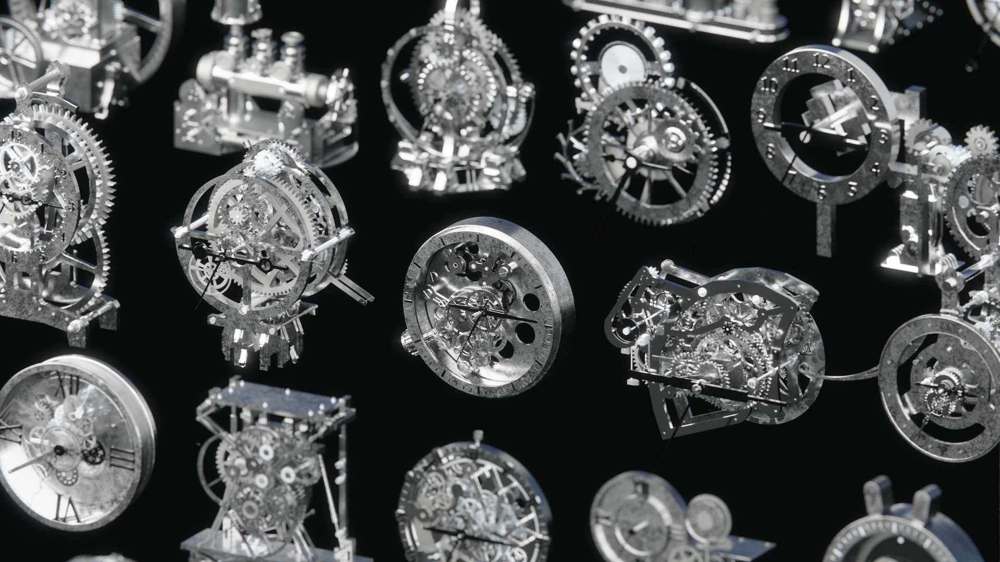

# Render gallery

[Back to the case study](../README.md) · [Watch the silent 1080p camera tour](../media/collection-tour.mp4)

## Collection views

### Clock collection

Frame from `Overall.mp4`, selected at 4.5 seconds. The original camera composition and render appearance are preserved.

### Clocks and architectural mechanisms

Frame from `Overall_move along.mp4`, selected at 6 seconds. [Open the moving camera tour](../media/collection-tour.mp4).

### Portrait collection study

Frame from `2_render.mp4`, selected at 1 second. This retains the portrait composition supplied with the product presentation.

## Individual assets

| Asset | Full-size render | What to inspect |
| --- | --- | --- |
| CLK08 | [Exposed clock movement](../media/clock-08.png) | Gear layers, frame, shafts and clock hands. |
| CLK23 | [Meridian palace](../media/clock-23.png) | Architectural arcade, large wheel and upper clock face. |
| SPM11 | [Oculus iris gate](../media/iris-gate.png) | Radial leaves, ring, bearings and drive assembly. |
| SPM14 | [Equinox](../media/differential-instrument.png) | Suspended linkage, frame and counterweights. |

These four images are unchanged copies of the supplied thumbnail renders, at their original resolution.

## Motion studies

[Clock collection preview](../media/collection-motion.gif) · [CLK23 mechanism](../media/arcade-motion.gif) · [SPM11 iris](../media/iris-motion.gif)

The GIFs are compressed excerpts of existing videos. They repeat for browsing and preserve source playback speed; repetition does not imply that the cut points form seamless mechanical cycles.

See [media provenance](media.md) for the exact sources.
