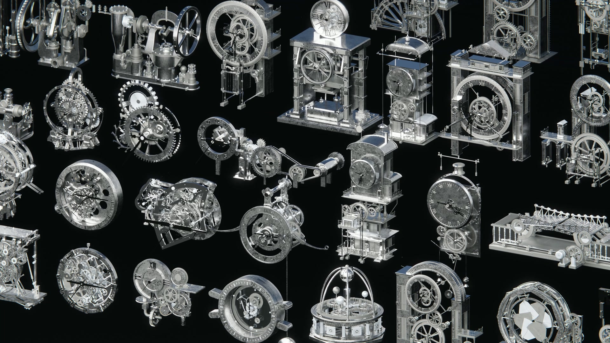
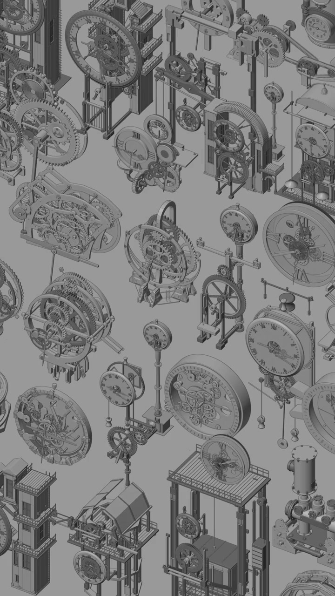
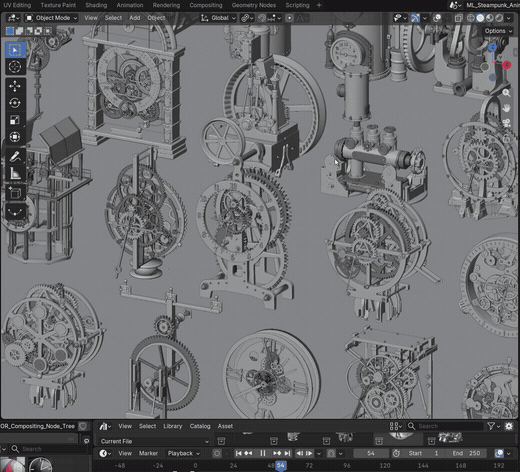
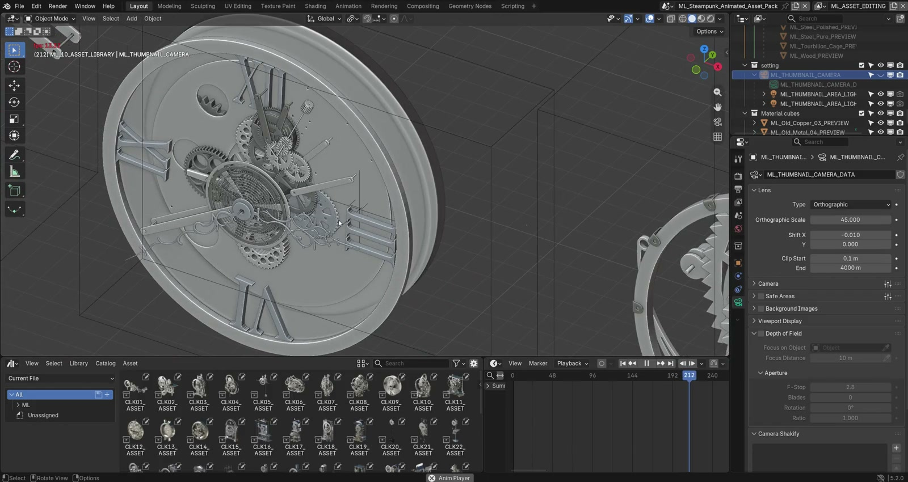
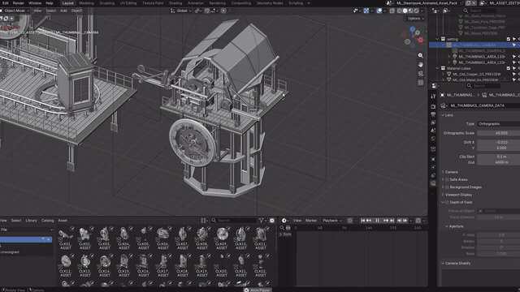
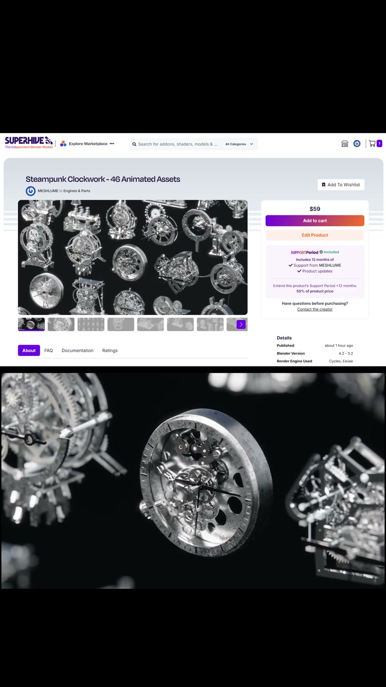

# Clockwork: videos and workflow recordings

[← Case study](../README.md) · [24 motion studies](motion-library.md#24-clock-motion-studies) · [Render gallery](render-gallery.md) · [Source notes](media.md)

Seven viewing copies connect the finished collection to its working Blender scene. Click any preview or the MP4 link to open the file; GIF excerpts animate directly on this page.

## 01 / Rendered camera tour

Inspect the collection as a finished visual product.

[Open MP4](https://muwentrili.github.io/creative-workflows/films/?project=clockwork&film=collection-tour)

## 02 / Linework collection

Read structure without the material pass.

[Open MP4](https://muwentrili.github.io/creative-workflows/films/?project=clockwork&film=lineweight-collection)

## 03 / The collection in Blender

Compare moving mechanisms in one scene.

[Open MP4](https://muwentrili.github.io/creative-workflows/films/?project=clockwork&film=viewport-collection)

## 04 / Asset Browser tour

See the library and asset selection.

[Open MP4](https://muwentrili.github.io/creative-workflows/films/?project=clockwork&film=blender-library-tour)

## 05 / Opening mechanism

Inspect the working assembly in the original recording.

[Open MP4](https://muwentrili.github.io/creative-workflows/films/?project=clockwork&film=opening-in-blender)

## 06 / Place an asset

See the library-to-scene step.

[Open MP4](https://muwentrili.github.io/creative-workflows/films/?project=clockwork&film=library-placement)

## 07 / Product presentation

Original vertical product-page and rendered-footage presentation.

[Open MP4](https://muwentrili.github.io/creative-workflows/films/?project=clockwork&film=product-presentation)

These existing viewing copies are silent. Recordings are selected excerpts where noted in the source record; they do not demonstrate every controller or a newly verified Skill run. Blender source assets remain distributed through the product page.
