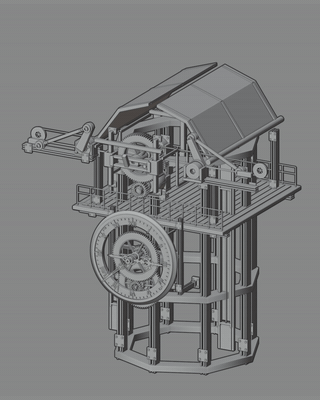

# From mechanical assets to a reusable workflow Skill

[Case study](../README.md) / [Read the Skill instructions](../skills/clockwork-assembly/SKILL.md) / [Controls](controls.md) / [Component reuse](component-reuse.md)

Steampunk Clockwork combines a visual design system, linked motion and reusable Blender components. The asset library carries the geometry and mechanisms. The workflow Skill gives an agent a repeatable way to inspect those mechanisms, adapt a module and check the result.

## Five reusable capabilities

| Capability | What the workflow does | Concrete output and evidence |
| --- | --- | --- |
| Design rules | Read an original model collection and apply the designer's direction to silhouette, gear layers, frame proportions and detail. | A coherent family of mechanical forms; [design process](process.md). |
| Mechanism structure | Identify how gears, shafts, chains, frames and moving modules relate through the existing hierarchy, drivers and constraints. | A dependency map from input to motion; [control examples](controls.md). |
| Parameter design | Expose meaningful adjustments for speed, phase, clock behavior, guided travel and unfolding. | Editable controller inputs instead of changes to each moving part; [parameter reference](controls.md). |
| Modular reuse | Choose a complete mechanism, an animated subassembly or selected geometry and materials for a new composition. | A working copy with the required dependencies preserved or rebuilt; [reuse workflow](component-reuse.md). |
| Product delivery | Organize assets, categories, previews and instructions so another creator can browse, place and adapt them. | 46 animated assets, custom Asset Browser previews and documented controls; [product case](../README.md). |

## A repeatable input-to-output path

**Design brief + source module -> inspect dependencies -> compose and tune -> preview and check -> reusable working copy**

| Input | Decisions | Intended output |
| --- | --- | --- |
| A licensed local asset, a target visual direction and the required motion | Which components to reuse; which controller owns each behavior; which dependencies must travel with the module | An adapted Blender working copy, a parameter change log, dependency notes and a preview when requested |

The method applies at different scales: a clock can anchor a scene, a gear train can become a detail, and an architectural mechanism can supply a larger movement. Combining visible components may require rebuilding their motion relationships.

## Existing mechanisms that ground the workflow

<table>
<tr>
<td width="25%" align="center"> <b>Gear rhythm</b> Separate gear and clock timing</td>
<td width="25%" align="center"> <b>Chain drive</b> Connected movement controls</td>
<td width="25%" align="center"> <b>Guided travel</b> Retain the existing rail path</td>
<td width="25%" align="center"> <b>Opening motion</b> Control the upstream input</td>
</tr>
</table>

## What is packaged as a Skill

The repository now includes [`clockwork-assembly/SKILL.md`](../skills/clockwork-assembly/SKILL.md), an instruction-based Skill distilled from the documented project workflow. It covers inspection, control changes, module reuse and checking the adapted result. It uses an existing Blender environment and assets supplied by their owner.

**Example request:**

> Use the clockwork-assembly Skill to adapt CLK31 for a new composition. Keep its rail mechanism, make the travel slower, and record the controller changes in a separate working copy.

An agent following the Skill should first inspect the actual root controller and dependencies, adjust the available timing inputs, check the changed motion, then return the working copy and change log. This is an example invocation, not a claim that this derivative scene has already been produced.

## My contribution and the role of AI

I modeled the original source collection myself, organized it as input and references, set the design direction, reviewed mechanical variations and shaped the library as a usable creative product. Codex assisted source inspection and the development of structures and gear linkages under those constraints. The Skill makes the adaptation procedure explicit so those decisions can be carried into another task.

## Evidence and current status

The renders, motion studies, controller documentation and delivery are existing project evidence. The Skill was exercised on a bounded [CLK32 speed-adjustment task](control-study.md), from inspection to a checked working copy and diagnostic preview. A new composition, hidden-dependency repair and independent creator use remain unverified. The model files are supplied separately through the product, and are not included in this instruction package. See [verification scope](validation.md).
